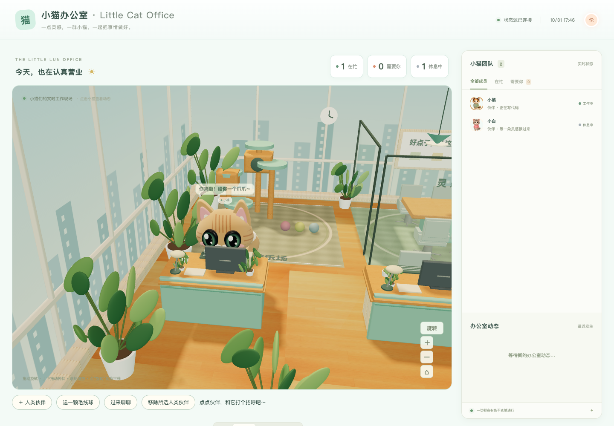
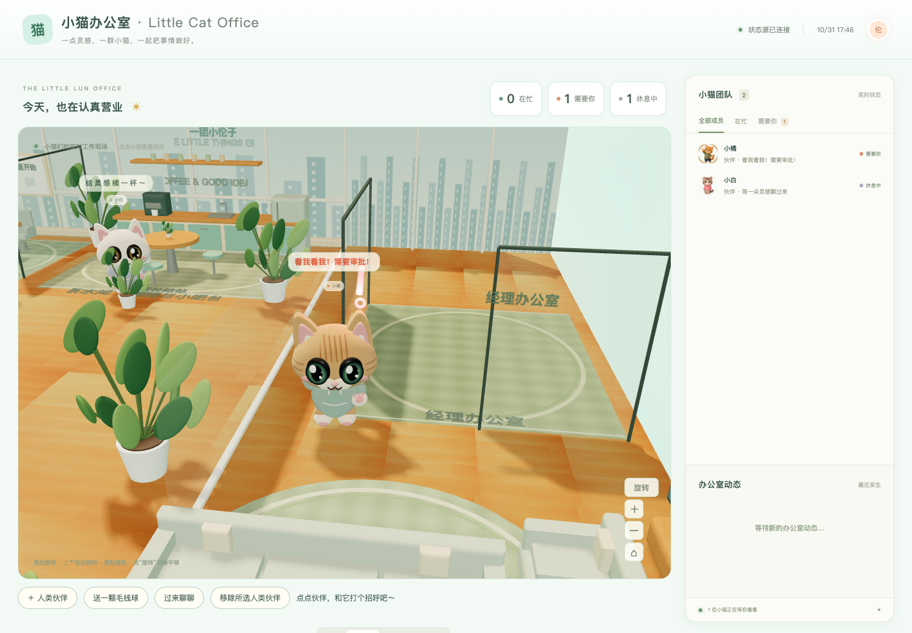
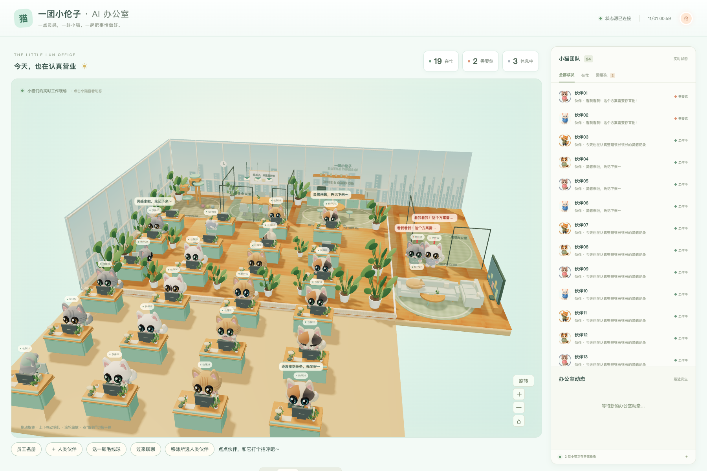

# Little Cat Office

A local 3D office that turns agent status into cats working, walking, resting, and asking for your attention.

[中文](README.md) · [Quickstart](docs/QUICKSTART.md) · [Status specification](docs/STATUS_SPEC.md)

## Start in three steps

Requires Python 3.10+ and Node 18+ for npm (Python alone can run the server).

1. **Install:** run `npm install` in the downloaded repository.
2. **Start:** run `npm start`, then open http://127.0.0.1:8770/app/ .
3. **Paste to your agent:** copy the instructions from the empty-office guide into AGENTS.md or your agent chat. One-click Codex, Claude Code and WorkBuddy examples are included.

Paste-ready instruction:

> Report your status to http://127.0.0.1:8770/api/status using a stable ID. POST JSON {"id":"my-agent","name":"My agent","state":"working","task":"Current task"} when starting, idle when done, and need_you when requesting confirmation. Send an update every 60 seconds during long tasks. Never include private content. Your first report creates a cat and desk automatically; no roster configuration is needed.

```sh
python3 scripts/catctl.py set my-agent working 'Working on a task'
```

Fresh installs show an empty office. Roster, appearance edits and last reports persist in `.local/office.sqlite3`. Restart retains them. Stale reports still display idle after the configured timeout; their original stored state is retained. `npm start -- --demo` uses isolated in-memory example cats, never real data. Without Node, use `python3 server/server.py`.

| Working | Needs you |
| --- | --- |
|  |  |

## Features

Real Three.js geometry and articulated limbs; typing, walking, waving and resting; obstacle-aware routes; 360-degree orbit, tilt, zoom, pan and reset; day/evening/night lighting; greetings, yarn and temporary summons. Local human coworkers share task behavior. Their photo-derived colors, hairstyle and glasses are adjustable. This is a generic cartoon model, **not AI face reconstruction or guaranteed likeness**. Original photos are neither uploaded nor stored. Appearance settings persist in origin-scoped browser storage.

## Connect your bot

[HTTP webhook](adapters/generic-webhook/README.md), [Codex instructions](adapters/codex/README.md), [Claude Code hooks](adapters/claude-code/README.md), [MCP](adapters/mcp/README.md), [Python](adapters/python/README.md), [Node](adapters/node/README.md).

This is not an official Grok Bot plugin and does not automatically inspect agents. Your bot reports its own status. Attention bubbles do not approve tasks. Adapter README files distinguish protocol/integration testing from unverified host installation.

## Configuration

Runtime: `app/config.json`; template: `app/config.example.json`. `brand` changes branding, `statusUrl` defaults to `/api/status`, `pollIntervalMs` to 1000 and `offlineAfterMinutes` to 30. Legacy JSON pull sources remain compatible. Cross-origin sources require their own CORS policy; the bundled server does not permit cross-origin writes.

Server: `--port 9000`, `--offline-after 300` (seconds). Clients use `CAT_OFFICE_URL`, `CAT_ID`, `CAT_NAME`. Optional `CAT_OFFICE_TOKEN` authenticates both GET and POST. The browser asks for it and keeps it only in page memory. Never commit actual credentials.

## Tests

```sh
npm test
npx playwright install chromium
# With npm start running in another terminal:
npm run test:browser
```

Use OFFICE_URL for a different server, CHROME_PATH for an installed browser. CI runs unit, HTTP, adapter and browser tests. No node_modules are shipped.

## FAQ

**Why offline?** No update for 30 minutes (idle by default; optional offline). Tool-start/end events are not continuous heartbeats.

**Port unavailable?** Choose another port and update CAT_OFFICE_URL for clients.

**Public hosting?** The included loopback server is for local personal use. See [SECURITY](SECURITY.md).

**Photo likeness?** Only approximate color extraction and adjustable cartoon features are currently implemented; automatic identity reconstruction is not.

**Paid calls?** None. All runtime assets are bundled and photo processing stays local.

## License

MIT. See [LICENSE](LICENSE), [NOTICE](NOTICE.md), [ASSETS](ASSETS.md). Three.js retains its original MIT license.

一团小伦子 · 深圳市有点东西文艺创作有限公司

## 名册与气泡 / Roster and bubbles

See [BUBBLES_ROSTER](docs/BUBBLES_ROSTER.md) for roster editing, unreported desk seats, the three-bubble queue, full hover text, and `staleBecomes` (default `idle`). Initialize with `python3 scripts/catctl.py init --from examples/roster.example.json`. Default rosterMode is auto; manual rosters require rosterMode=manual.



本机 SSE 已支持：`GET /api/events`，无需公网；断线重连及轮询兜底。See [status specification](docs/STATUS_SPEC.md).

Manage names, avatars and deletion in the Employee roster dialog. Deleted agents can rejoin by reporting again. See [onboarding and persistence](docs/ONBOARDING.md).

## 行为与领导 / Behavior and leader

[工位动作、80% 在岗调度、专属领导猫](docs/BEHAVIOR_LEADER.md)。可在网页名册设置唯一 role=lead；测试统计见 docs/behavior-qa.json。

## 自动主 CEO 与派工 / Auto CEO and assignments

明确指定的领导优先，其次按派工 from 自动识别；尚无派工时第一位上报成员暂任领导。使用 `POST /api/assign {from,to:[...],task}` 或 `catctl assign`，接收者会去经理室开约 5 秒短会后回工位。[接入与示例](docs/ASSIGNMENTS.md)。

## Desktop launcher / 桌面启动

Install Python 3 and Node.js, then run `npm install` and `python3 scripts/catctl.py install-launcher`. 双击桌面的「小猫办公室」即可后台启动并打开浏览器。Logs: `.local/server.log`.

Optional: `python3 scripts/catctl.py autostart on`; disable with `autostart off`. macOS uses launchd KeepAlive; Linux uses systemd --user (logs in journalctl --user); Windows uses a Startup folder supervisor checking every 5 seconds. Windows off removes next-login startup; the current supervisor ends at logout. Keep the checkout in place; reinstall the launcher after moving it. Linux may require marking the desktop file trusted.

> **写入警告 / Writes to the active roster:** 示例 curl 和 `catctl set` 会写入当前运行的办公室名册。演示请启动 `python3 server/server.py --demo --port 8771` 或 `python3 server/server.py --data-dir /tmp/cat-office-demo --port 8771`，并将示例 URL / `CAT_OFFICE_URL` 指向该端口。Examples modify the running office roster; use a demo or temporary data directory and point all clients at its port. 误写可通过名册 UI 或 `POST /api/roster`，请求体 `{"id":"example-id","action":"delete"}` 删除。Delete accidental entries using the roster UI or that API.
