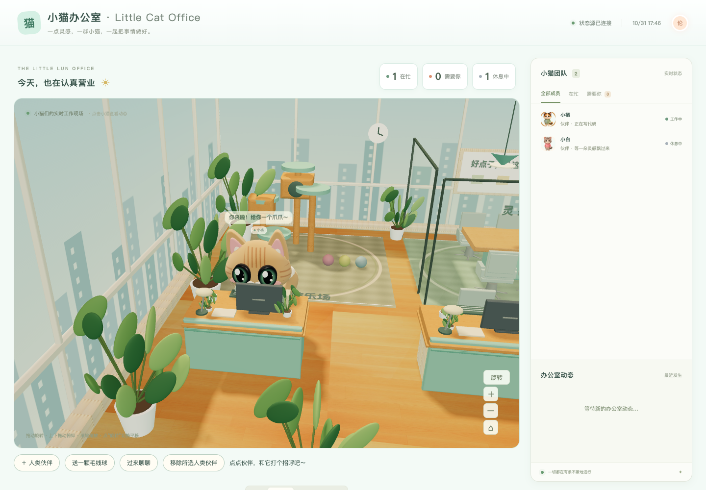
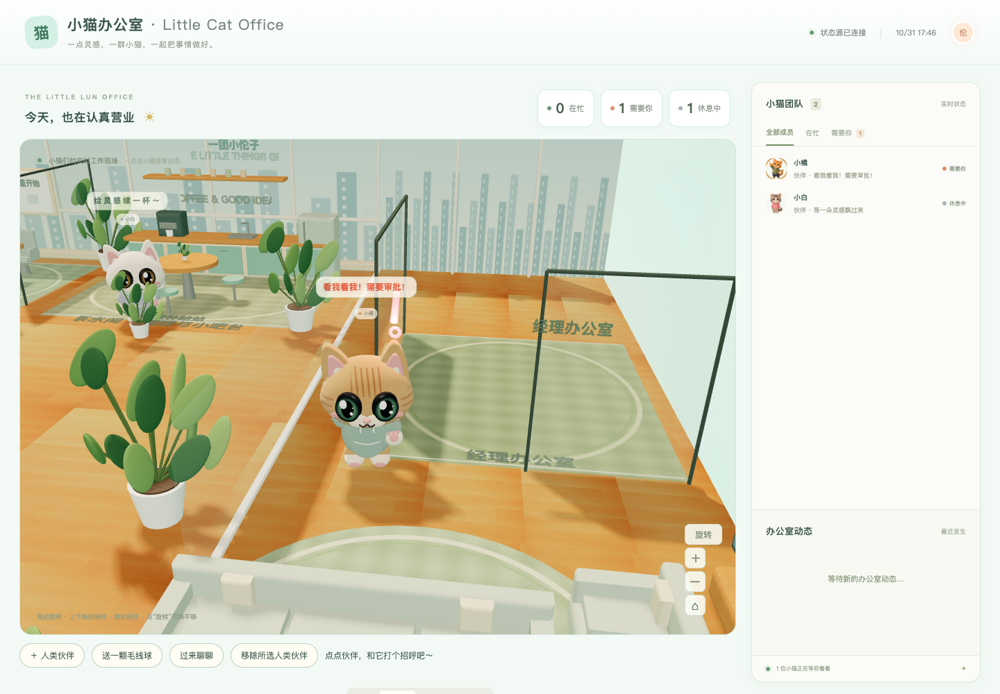

# 小猫办公室 · Little Cat Office

把智能体的工作、休息和待确认状态，变成一间可以走动的 3D 小猫办公室。

[English](README.en.md) · [5 分钟接入](docs/QUICKSTART.md) · [状态格式](docs/STATUS_SPEC.md)

| 工作中 | 需要你审批 |
| --- | --- |
|  |  |

## 5 分钟上手

需要 Python 3.10+；安装/测试工具需要 Node 18+。无需模型账户、付费 API、CDN 或构建步骤。

```sh
npm install && npm start
```

打开 http://127.0.0.1:8770/app/ 。无 Node 时直接运行：

```sh
python3 server/server.py
```

另开终端，在仓库目录推送你的 bot 状态：

```sh
python3 scripts/catctl.py set coder working '写代码中' --name 小橘
python3 scripts/catctl.py set coder need_you '看我看我！需要审批！' --name 小橘
```

更新约一秒内显示，小猫随后走到目标位置。长任务需定期上报；默认五分钟未更新会离线。重启恢复示例名单，推送状态不落盘。

## 功能

- 真正的 Three.js 立体猫咪、独立四肢动作、走路寻路、打字、挥手和休息。
- 360° 拖动旋转、俯仰、滚轮缩放、平移切换和复位；日/昏/夜光照。
- 点猫打招呼、送毛线球、召唤聊天，临时互动结束后返回任务。
- 本地卡通人类伙伴：照片取色、手动发型/眼镜/颜色、共享行为逻辑、可绑定 bot ID。**不是 AI 人脸重建，不保证本人相似度**；原照片不存储不上传，设置保存在当前浏览器来源。
- 拉取自有 JSON 或通过 HTTP、CLI、SDK、MCP 推送状态。

## 怎么接自己的 bot

| 方式 | 入口 |
| --- | --- |
| HTTP/curl | [generic-webhook](adapters/generic-webhook/README.md) |
| Codex 调用约定 | [Codex](adapters/codex/README.md) |
| Claude Code 事件脚本 | [Claude Code](adapters/claude-code/README.md) |
| MCP set_status | [MCP](adapters/mcp/README.md) |
| Python / Node SDK | [Python](adapters/python/README.md) / [Node](adapters/node/README.md) |

本项目不是 Grok Bot 官方插件，也不会自动读取所有智能体。需要你的 bot 主动上报。审批气泡只表示待处理，不执行批准操作。各适配器的实际验证范围见其 README。

## 配置

`app/config.example.json` 是示例，运行时读取 `app/config.json`。`brand` 控制品牌文案；`statusUrl` 默认 `/api/status`；`pollIntervalMs` 默认 1000；`offlineAfterMinutes` 默认 5。也可设置自有状态文件 URL，保留旧格式兼容。跨域源需自行设置 CORS，内置服务不开放跨域写入。

服务端参数：`--port 9000`、`--offline-after 300`（秒）。CLI/SDK 用 `CAT_OFFICE_URL`、`CAT_ID`、`CAT_NAME`。可选 `CAT_OFFICE_TOKEN` 开启 GET/POST 鉴权；浏览器通过“连接状态源”输入，只在页面内存保留。勿把真实凭据放进配置或仓库。

## 开发与测试

```sh
npm test
npx playwright install chromium
# 启动 npm start 后，在另一个终端：
npm run test:browser
```

`OFFICE_URL` 可以选择测试服务地址；`CHROME_PATH` 可以选择已有 Chromium/Chrome。CI 使用 Ubuntu、Python、Node 和 Playwright，运行相同测试并保留浏览器截图。运行不需要 node_modules；它只供开发测试，未纳入仓库。

## FAQ

**为什么变离线？** 五分钟未收到更新。长任务应发送心跳；仅有任务开始和结束事件不能保证中途在线。

**为什么打不开？** 检查 Python 版本和端口占用。更换端口后同步修改 CLI 的 CAT_OFFICE_URL。

**能放到公网吗？** 内置服务仅供本机个人使用，不是多用户生产服务。见 [安全说明](SECURITY.md)。

**会收费或上传朋友照片吗？** 本仓库没有收费调用；本地照片仅用于近似取色，不会上传。

**免费就能得到精确真人分身吗？** 不能。目前是可调参数的通用卡通 3D 人。

## 许可与致谢

MIT，见 [LICENSE](LICENSE)。素材来源与分发边界见 [ASSETS.md](ASSETS.md)、[NOTICE.md](NOTICE.md)。Three.js 保留其原始 MIT 声明。

一团小伦子 · 深圳市有点东西文艺创作有限公司
